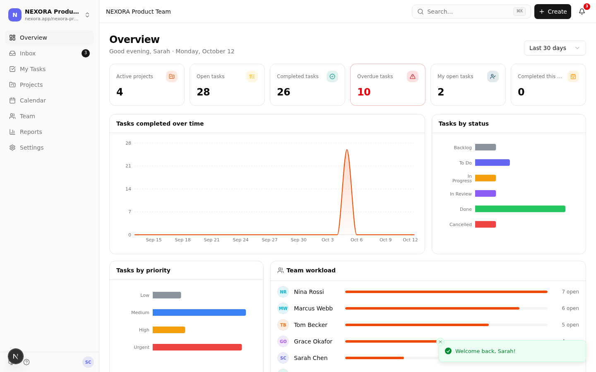
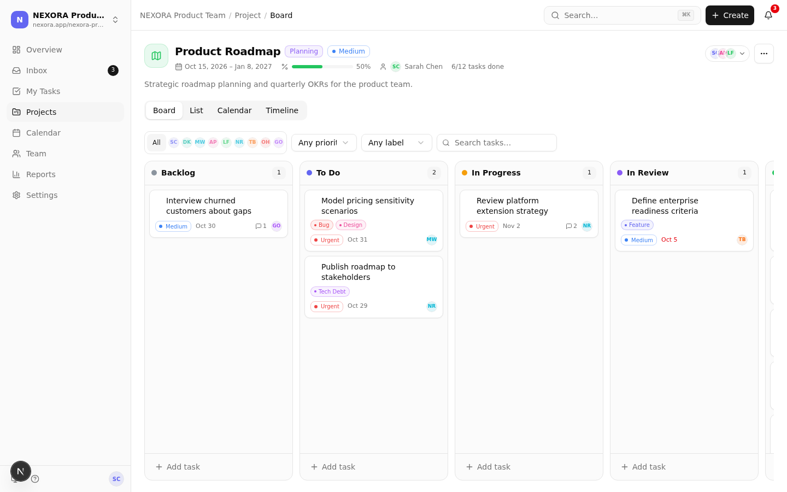
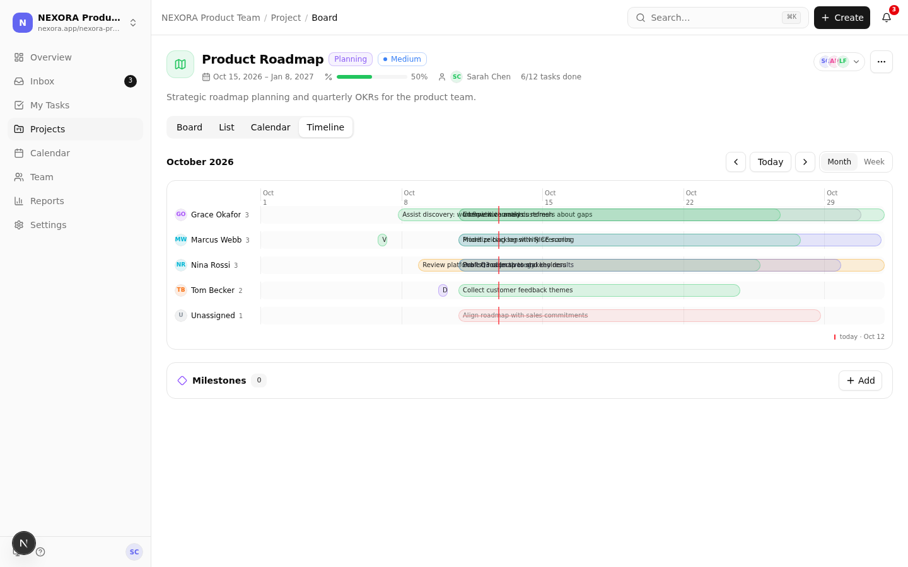
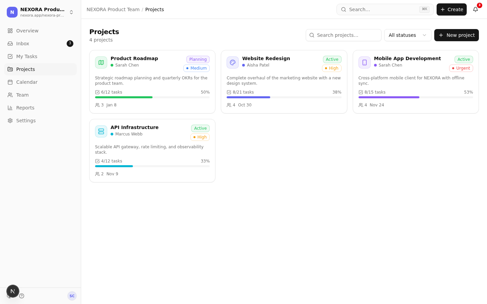
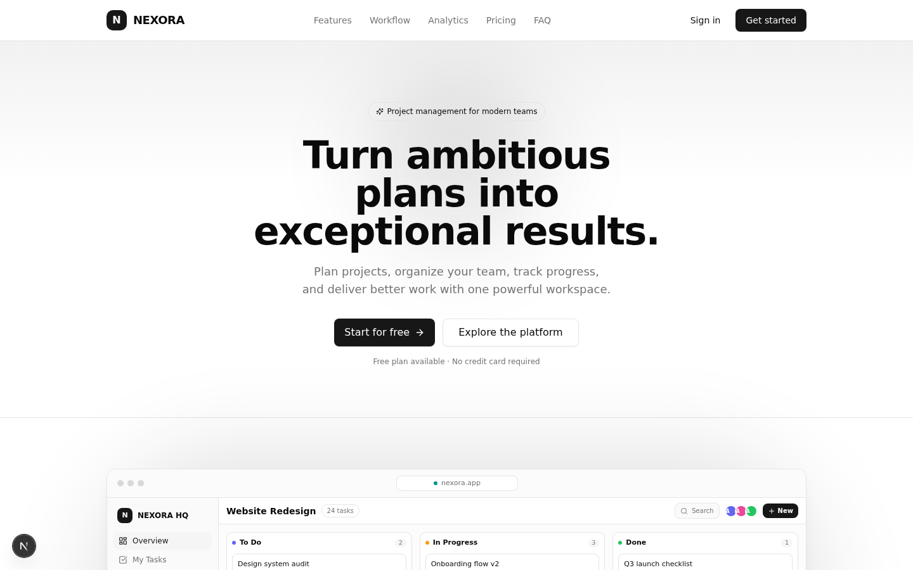
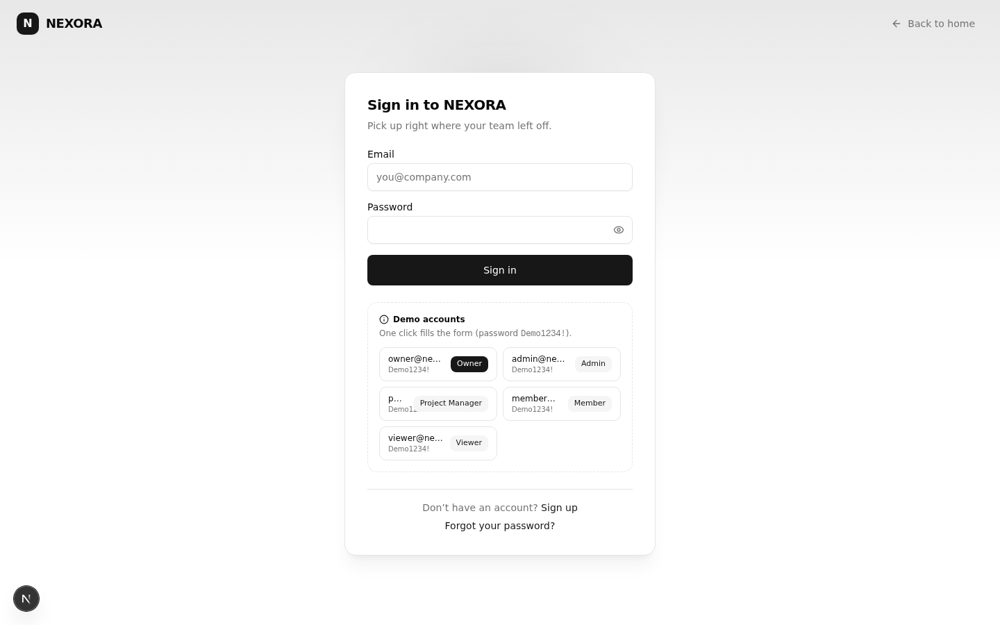

<div align="center">

# 🚀 NEXORA

### Plan smarter. Build together. Deliver better.

**A full-stack project management workspace** — projects, kanban boards, tasks, timeline, calendar, team collaboration, analytics and billing, in one polished app.

[](https://nextjs.org)
[](https://www.typescriptlang.org)
[](https://www.prisma.io)
[](https://tailwindcss.com)
[](LICENSE)

</div>

---

## ✨ Highlights

- 🏠 **Landing page** — animated hero, feature showcase, pricing & FAQ
- 🔐 **Authentication** — email/password with sessions, role-based access (owner, admin, project manager, member, viewer), password reset
- 🏢 **Workspaces** — multi-workspace support with per-workspace members, labels & settings
- 📊 **Dashboard** — KPI cards (active projects, open/completed/overdue tasks), completion trends & status charts
- 📁 **Projects** — 4 views per project: **Board (Kanban)** · **List** · **Calendar** · **Timeline (Gantt)**, plus milestones & progress tracking
- ✅ **Tasks** — rich task dialogs, priorities, labels, assignees, due dates, comments, attachments, dependencies, bulk actions & drag-and-drop reordering
- 📥 **Inbox & Notifications** — activity feed with read/unread states
- 👥 **Team management** — invitations (email + resend), roles, member removal
- 📈 **Reports** — analytics with date-range filtering
- ⚙️ **Settings** — profile, workspace & billing tabs with subscription lifecycle (plans, cancel, resume)
- 🌓 **Dark / light mode**, responsive from mobile to desktop, toast feedback & skeleton loaders

## 🖼️ Screenshots

| Dashboard | Kanban Board |
|---|---|
|  |  |

| Timeline | Projects |
|---|---|
|  |  |

| Landing | Sign in |
|---|---|
|  |  |

## 🧱 Tech Stack

| Layer | Technology |
|---|---|
| Framework | **Next.js 16** (App Router) + **TypeScript 5** |
| UI | **Tailwind CSS 4** · **shadcn/ui** (Radix primitives) · Lucide icons |
| State | **Zustand** (client) · TanStack-style fetching |
| Backend | Next.js **API Routes** (REST) |
| Database | **Prisma ORM** + SQLite |
| Auth | Custom session-based auth (cookie + bcrypt) |
| Extras | dnd-kit (drag & drop), Recharts (charts), next-themes |

## 🚀 Getting Started

```bash
# 1. Install dependencies (bun or npm)
bun install

# 2. Configure environment
echo 'DATABASE_URL="file:./db/custom.db"' > .env

# 3. Create the database schema
bun run db:push

# 4. Start the dev server → http://localhost:3000
bun run dev
```

### 🧪 Demo accounts

The sign-in page includes one-click **"Fill demo form"** buttons:

| Role | Email |
|---|---|
| Owner | `owner@nexora.dev` |
| Admin | `admin@nexora.dev` |
| Project manager | `pm@nexora.dev` |
| Member | `member@nexora.dev` |
| Viewer | `viewer@nexora.dev` |

Demo password: `password123`

## 📂 Project Structure

```
src/
├── app/
│   ├── api/            # REST API (auth, workspaces, projects, tasks, billing…)
│   ├── layout.tsx      # Root layout + providers
│   └── page.tsx        # Entry point (landing → app shell)
├── components/         # Feature views (landing, dashboard, projects, tasks…)
│   └── ui/             # shadcn/ui component library
├── lib/                # db client, auth, permissions, validation, rate-limit
├── store/              # Zustand app store
└── types/              # Shared TypeScript types
prisma/schema.prisma    # Database schema
db/custom.db            # SQLite database (seeded with demo data)
```

## 🔑 Key API Endpoints

```
POST   /api/auth/register|login|logout|forgot-password|reset-password
GET    /api/auth/me
GET    /api/workspaces                       POST /api/workspaces
GET    /api/workspaces/:id/dashboard         # KPIs + charts
GET    /api/workspaces/:id/projects          POST /api/workspaces/:id/projects
GET    /api/workspaces/:id/my-tasks          /calendar  /activity  /analytics
POST   /api/projects/:id/tasks               GET/POST /api/projects/:id/milestones
PATCH  /api/tasks/:id                        POST /api/tasks/bulk  /reorder
POST   /api/tasks/:id/comments  /attachments  /dependencies
GET    /api/notifications                    PATCH /api/notifications/read-all
GET    /api/billing/plans                    POST /api/billing/webhook
GET    /api/search?q=                        # global search
```

## 📄 License

MIT — free to use, modify and distribute.

---

<div align="center">
Built with ❤️ using Next.js, Tailwind CSS and shadcn/ui
</div>
